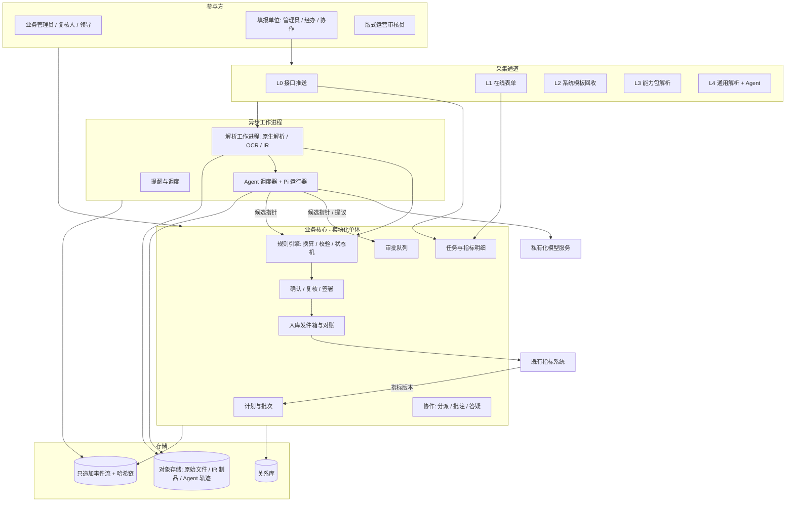
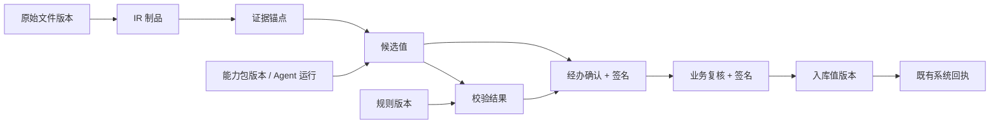

# 02 优化方案（可落地版）

> 本文是在原方案 V1.2 基础上的修订设计。未提及的部分（四级对象、分级签署、批量操作、看板、催办）沿用原方案。
> 文中的数值门槛、选型均为**建议值或候选项**，需在阶段 0 用真实样本测量后定稿（见 [04](04-roadmap-acceptance.md)）。

## 1. 设计原则修订

在原方案 1.5 八条原则之上，新增或强化以下六条：

| 原则 | 要求 | 检查点 |
|---|---|---|
| 源头结构化优先 | 能用接口、在线表单、系统模板采到的，不走文件识别。识别只服务于改不了格式的存量材料。 | 每个批次统计各通道占比；L2 及以上通道占比是运营指标。 |
| 模型只给指针，不产数 | 大模型和 Agent 的输出只能是 IR 节点 ID、指标 ID、维度取值和理由。数值、单位由程序从 IR 读取并换算。 | 候选值入库前校验 `value_raw == IR[anchor].text`，不等即丢弃。 |
| 构建期用 Agent，运行期走确定性 | 高频版式由 Agent 写成声明式能力包，人审后发布；运行期按能力包确定性执行。Agent 的运行期抽值只用于长尾。 | 各路径产出的候选占比、各路径档内错误率。 |
| 正交状态，事件为源 | 流程、取值来源、值处置、校验、证据五个维度分开建模；状态由只追加的事件派生。 | 任一当前状态可由事件流重放得到。 |
| 确认强度与风险匹配 | 确定性导入可批量确认；AI 候选按档位核对；关键指标双人或盲录。 | 入库差错率、AI 采纳后被推翻率。 |
| Agent 只提议，人批准 | Agent 没有确认、复核、签署、入库、发布身份。有副作用的动作进入审批队列。 | Agent 服务账号的权限清单；审批队列记录。 |

## 2. 目标架构



部署形态：一个业务核心应用（模块化单体，内部按模块分包），加三类可独立伸缩的工作进程（解析、Agent、提醒调度）。原方案 7.2 的八个服务保留为模块边界，等某个模块出现独立伸缩或独立发布需求时再拆。理由：解析和 Agent 的资源画像（CPU、GPU、长任务）与业务事务不同，必须隔离；其余模块之间事务耦合强，拆开只会增加分布式一致性成本。

## 3. 分级采集通道

系统在生成任务时就知道“向谁要哪些指标、什么维度、什么单位”，应优先用这一信息把采集做成结构化的。

| 通道 | 方式 | 取值方法 | 需要 AI | 证据 | 适用 |
|---|---|---|---|---|---|
| L0 接口推送 | 数源系统按接口报送，或从既有系统取数 | 字段直接映射 | 否 | 报文摘要、对方回执 | 有业务系统的单位 |
| L1 在线表单 | 经办人在页面逐项录入，可粘贴整列 | 录入即结构化 | 否 | 可选上传佐证文件并框选位置 | 指标少、无现成报表 |
| L2 系统模板回收 | 系统按任务生成 Excel 模板下发，填好后上传 | 按模板内嵌绑定读取，确定性导入 | 否 | 模板版本、单元格地址 | 指标多、单位习惯用表格 |
| L3 能力包解析 | 上传单位自有固定格式报表 | 已发布版式能力包确定性抽取 | 构建期 | 多态锚点 | 高频、版式稳定的存量报表 |
| L4 通用解析加 Agent | 上传陌生文件、扫描件 | 通用规则与 Agent 给出候选指针 | 是 | 多态锚点 | 长尾、首次出现的版式 |

**L2 模板的关键设计**（这是提升准确率成本最低的一步）：

- 每个待填单元格在隐藏工作表中登记 `item_id、指标版本、维度键、目标单位、精度`，并用定义名称绑定，不依赖行列位置。
- 模板带 `template_id、task_id、批次期间、模板摘要`。上传时先验摘要与任务归属，结构被改动（删行、改表头）则降级为 L3/L4 处理并提示。
- 表内预置数据有效性（数值、范围、必填）和合计公式，错误在填的时候就暴露。
- 单位可在模板中附“来源说明”列，填写数据出处（文件名、页码），作为人工证据。

**通道路由**：上传文件后依次判断——带有效模板标识走 L2；版式指纹命中已发布能力包走 L3；否则走 L4。任何通道失败都回落到 L1 人工录入，不阻断办理。同一任务可混用多个通道。

**通道升级**：L4 中同一版式指纹累计出现达到阈值（建议 3 次或 3 家单位）即自动创建“能力包编写”Agent 作业（见 03 §4），把它升到 L3。运营目标是让 L4 占比逐期下降。

## 4. 多方协作设计

### 4.1 协作面

| 协作关系 | 原方案 | 修订 |
|---|---|---|
| 业务部门对填报单位 | 分发、催办、退回 | 增加口径答疑、批次变更通知、部分退回 |
| 单位内部多人 | 协作成员按授权处理 | 指标级分派与认领、进度到人、批注线程、代办与交接 |
| 主责单位对配合单位 | 区分单位类型 | 配合单位任务与主责任务关联，主责可见配合进度，汇总前需配合单位确认 |
| 人对 Agent | 无 | 各角色助手、提议与审批（见 03） |

### 4.2 指标级分派与并发

- 单位任务管理员可按指标分组把明细分派给不同经办人或内部科室；也可开放认领。`item_assignment` 记录分派人、承办人、期限。
- 每条明细带 `version`。保存时带上版本号，不一致返回 `VERSION_CONFLICT` 并展示对方的修改，由用户选择。不做实时协同编辑，成本高且没有必要。
- 整单提交权只在任务管理员或被指定的提交人手里；提交前系统列出每个承办人的完成情况。
- 代办与交接：经办人可把名下明细转给同单位他人，需填写原因，产生 `ITEM_REASSIGNED` 事件；已确认的值保留原确认人。

### 4.3 批注与口径答疑

- 批注线程绑定到明细、文件或证据锚点，支持提及他人。线程有“待答复、已答复、已关闭”状态，未关闭的答疑会出现在双方待办中。
- 向业务部门提问的线程标记为“口径答疑”。业务部门的答复可一键沉淀为该指标的“填报说明”，后续同指标的所有单位可见，减少重复提问。
- 每条明细提供填报说明卡：指标定义、制度依据、口径说明、常见错误、上期值（仅供核对，沿用原方案 1.6 的限制）。

### 4.4 部分退回与增量签署

- 复核结论逐项给出。退回只打开被退回的明细；已通过的明细锁定为只读，其复核结论保留。
- 提交清单改为默克尔结构：每条明细一个叶子摘要，覆盖 `item_id、指标版本、维度键、确认值、单位、值处置、证据锚点摘要、文件摘要`；签名对象是根摘要加清单元数据。
- 补正后重新提交时，生成新版清单，只有被修改的叶子变化。系统可以向复核人精确展示“本次变了哪几项”，未变化的叶子沿用已有复核结论，复核人只看差异。
- 经办人仍对新的根摘要签署一次，签署成本不变，但复核工作量只与变化项成正比。

### 4.5 数据复用

同一单位的同一“指标版本 + 维度键 + 期间”已有入库值时，新任务中该明细直接带出，来源标记为“复用”，附原入库记录链接。经办人确认是否仍然有效；确认后进入正常复核。复用值不得跳过确认。

### 4.6 批次变更单

在途批次的任何调整（增加或取消指标、增减单位、口径勘误、延期）都通过变更单进行：

1. 业务管理员填写变更内容与依据，系统给出影响预览（受影响任务数、已确认明细数）。
2. 审批通过后生成新的批次规则快照版本。新增明细进入待填报；取消明细标记为已取消并保留已填内容；口径勘误使受影响的已确认明细回到待确认，并附勘误说明。
3. 向受影响单位发送变更通知，待办中单独列出“因变更需重新确认”的明细。

这样既保持“已下发任务不被静默回改”，又给了现实中必然发生的调整一条留痕的路。

### 4.7 更正流程

入库后的更正由更正单驱动，发起方可以是填报单位或业务部门：

| 步骤 | 内容 |
|---|---|
| 发起 | 选择已入库明细，填写更正原因，上传新证据 |
| 确认与复核 | 走与正常报送相同的确认、复核、签署流程 |
| 入库 | 生成新数据版本写回既有系统；原版本标记为“已被更正”，不删除 |
| 下游通知 | 查出引用过旧版本的数据支撑附件和导出记录，通知其导出人与主题负责人；附件页面显示“所引数据已更正” |

## 5. 状态模型重构

### 5.1 指标明细的五个正交维度

| 维度 | 取值 | 说明 |
|---|---|---|
| 流程状态 | 待填报、待确认、已确认、已提交、单位内审通过、复核通过、复核退回、入库中、已入库、入库失败、已取消 | 唯一的主状态，只由人的动作或入库回执推进 |
| 取值来源 | 接口、在线录入、模板导入、能力包、Agent 候选、复用、人工修改、人工补录 | 决定确认档位 |
| 值处置 | 有值、无数据、不适用 | 无数据和不适用同样要走确认与复核 |
| 校验状态 | 未校验、通过、提醒未处理、提醒已说明、硬性失败 | 硬性失败阻断提交 |
| 证据状态 | 无、已锚定、锚点失效（文件已换版）、人工佐证 | 决定能否确认 |

原方案的“AI 已预填、自检待完成、多候选待选”不再是状态，而是界面根据“流程状态 = 待确认”加上候选数量、校验状态计算出来的标签。

### 5.2 单位任务状态由明细聚合派生

单位任务保留少量由人触发的状态（待接收、办理中、已提交、已关闭），其余展示用状态由明细聚合计算，例如“部分退回（3 项）”“部分入库（120/126）”。这解决了原方案中任务级“已入库”无法表达部分完成的问题。

### 5.3 入库中间态

复核通过并签署后，在同一个本地事务里写入明细状态“入库中”和一条发件箱记录。独立进程读取发件箱调用既有系统的幂等接口：成功则记录回执并置为“已入库”；失败按退避重试，超过次数置为“入库失败”并告警。每日对账任务比对双方的条数与摘要，差异进入对账工作台人工处理。

### 5.4 补充的状态转换

- 撤回：已提交且尚未开始复核的任务，提交人可撤回，回到已确认，原签名标记作废。
- 文件换版：证据状态变为“锚点失效”的明细，流程状态回到待确认（见 §6.1）。

## 6. 识别管线修订

### 6.1 Document IR 制品化

- IR 是由“文件摘要 + 解析器版本 + 配置”唯一决定的不可变制品，序列化为压缩 JSON 或列式文件存入对象存储，以内容摘要寻址。同样的输入必须得到同样的 IR 摘要，这是回归测试的基础。
- 关系库只存：文件、解析作业、IR 制品索引，以及**被候选值或确认值引用到的锚点**。不把每个单元格落成一行。
- 文件换版时，对新旧 IR 做结构比对。已确认明细的锚点在新版本中文本未变的，自动迁移锚点；文本变了或找不到的，证据状态置为“锚点失效”，只有这些明细需要重新确认。

### 6.2 多态证据锚点

| 文件类型 | 定位字段 | 展示方式 |
|---|---|---|
| Excel | 工作表名、单元格地址、所属合并区域、表头路径、显示文本、存储值、数字格式 | 表格渲染并高亮单元格 |
| Word | 段落或表格序号、单元格行列、字符起止偏移 | 文档渲染并高亮文字 |
| 电子 PDF | 页码、坐标框、文字片段 | 页面图像加框 |
| 扫描件、图片 | 页码、坐标框、识别文本、逐字符置信度 | 原图裁剪与识别结果并排 |
| 在线录入、接口 | 录入人或报文编号、时间、可选的佐证文件锚点 | 文本说明 |

```json
{
  "anchor_id": "AN-01HX…",
  "kind": "xlsx_cell",
  "file_id": "F-…", "file_hash": "sha256:…", "ir_hash": "sha256:…",
  "locator": { "sheet": "表3", "cell": "F17", "merged_range": null },
  "header_path": ["项目", "本期数", "金额"],
  "row_path": ["一、收入", "其中：经营收入"],
  "text": "12,345.67", "stored_value": "12345.6712", "number_format": "#,##0.00"
}
```

### 6.3 指针式抽值

1. 模型或 Agent 只调用 `propose_candidate(item_id, anchor_node_id, dimension, reason)`，参数里没有数值。
2. 程序从 IR 读取该节点的文本与存储值，执行数值规范化、单位换算，生成候选值。
3. 程序校验节点确实存在、是数值单元格、不在表头或备注区。任何一步不满足即拒绝该候选，并把拒绝原因返回给 Agent。
4. 文本类指标（非数值）同理，取值为锚点文本的原文片段，不接受模型改写。

这一条把“模型编造数字”“模型抄错小数位”从机制上排除，剩下的错误只可能是“指错了格子”，而这类错误可以被校验规则和人工看证据发现。

### 6.4 格式专项规则

| 类型 | 必须处理的情况 | 处理方式 |
|---|---|---|
| Excel | 公式单元格 | 同时读公式与缓存值；无缓存值时在隔离环境重算或标记“未计算” |
| Excel | 显示值与存储值不一致（四舍五入、以万为单位的自定义格式、百分比） | 两者都进 IR；取值按存储值，界面同时展示，差异超过精度则提示 |
| Excel | 隐藏行、列、工作表；筛选后的不可见行 | 进 IR 并标记隐藏；默认不参与匹配，合计校验时计入并提示 |
| Excel | 文本型数字、全角数字、带单位的文本（“1.2亿”） | 规范化规则处理，保留原文 |
| Excel | 外部链接、宏 | 不执行宏；外部链接值标记为“外部引用” |
| Word、PDF | 跨页续表、表头重复 | 按列数、列宽、表头文本一致性拼接，拼接处记录在 IR 中 |
| Word | 修订痕迹、批注 | 取接受修订后的文本，并提示“文件含未接受修订” |
| 扫描件 | 数字误识：小数点丢失、千分位与小数点混淆、负号与括号负数、0 与 O | 两个识别引擎比对，逐字符置信度低于阈值的数字强制进入 C 档；用合计关系反验 |
| 扫描件 | 印章遮挡、手写改动、倾斜、拍照畸变 | 检测到即标记区域，该区域内的值一律 C 档 |

### 6.5 校验规则库

规则分硬性（阻断提交）和提醒（需说明），由规则引擎确定性执行，规则本身有版本并随批次快照锁定。

| 类别 | 示例 | 级别 |
|---|---|---|
| 文件—任务一致性预检 | 文件标题或表头中的单位名称、报告期与任务不符 | 提醒，解析前即提示 |
| 表内平衡 | 合计等于明细之和（按精度容差） | 硬性 |
| 表间勾稽 | 指标 A = 指标 B + 指标 C；占比 = 分子 / 分母 | 硬性或提醒，按规则定义 |
| 量级 | 与上期值之比接近 10000、1000、100 或其倒数 | 提醒，提示“疑似单位错误” |
| 波动 | 同比、环比超出该指标的阈值 | 提醒，需填写原因 |
| 取值域 | 非负、整数、百分比不超过 100% | 硬性 |
| 证据 | 有值必须有锚点或人工佐证 | 硬性 |
| 重复 | 多个明细指向同一锚点 | 提醒 |

规则由业务人员在界面维护或由 Agent 起草（见 03 §4），发布前必须在历史已入库数据上试跑，展示命中率，避免误报泛滥。

### 6.6 双路交叉与可信度标定

“独立自检”定义为**用不同方法得到相同结论**，而不是让同一个模型再看一遍。可用的独立路径：

| 路径 | 方法 |
|---|---|
| A 规则路径 | 能力包或通用规则按表头路径匹配 |
| B Agent 路径 | Agent 通过工具浏览 IR 后给出指针 |
| C 历史路径 | 同一单位上期同版式文件中该指标所在的表头路径 |
| D 校验路径 | §6.5 的平衡、勾稽、量级规则 |

档位不再由加权分决定，而由可解释的条件决定：

| 档位 | 条件 | 确认方式（见 §7.1） |
|---|---|---|
| A 确定性 | L0–L2 通道导入，硬性校验通过 | 可批量确认 |
| B 高可信 | 至少两条独立路径指向同一锚点，全部校验通过，非关键指标 | 快速核对 |
| C 需逐项核对 | 仅一条路径、路径间不一致、任一提醒、扫描件低置信字符、关键指标、人工修改 | 逐项看证据确认 |
| 拒识 | 无候选或硬性校验失败且无法定位 | 人工录入 |

标定方法：在标注集上统计每个档位的错误率，调整进入 B 档的条件，使 B 档错误率不高于目标值（建议 0.5%，见 04 §3）。每次解析器、能力包、模型或提示词变更都要重跑并出具各档错误率；上线后用人工修改和复核退回数据持续监测，某类文件的 B 档错误率超标则自动把该类降到 C 档。

### 6.7 版式能力包规格

能力包是一份可以被人读懂、被版本管理、被自动回归的声明式文件，存放在内网 Git 仓库，评审对象就是它的差异。

```yaml
pack_id: unit-a-quarterly-income
version: 3
fingerprint:                 # 版式指纹，用语义特征而非坐标
  file_type: xlsx
  sheet_name_pattern: "表3.*收入"
  header_signature: ["项目", "本期数/金额", "本期数/同比", "累计数/金额"]
  min_similarity: 0.9
context:
  unit: { from: "regex", pattern: "单位[:：]\\s*(\\S+)", scope: "above_table" }
  period: { from: "title", pattern: "(\\d{4})年第([一二三四])季度" }
mappings:
  - metric: M1001              # 指标版本在批次快照中锁定
    row: { path_match: ["一、收入", "其中：经营收入"] }
    col: { path_match: ["本期数", "金额"] }
    dimension: { period: "$context.period" }
  - metric: M1002
    row: { text_match: "合计", is_total: true }
    col: { path_match: ["累计数", "金额"] }
checks:
  - balance: { total_row: "合计", detail_rows: "一、*|二、*", cols: "*金额" }
tests:
  samples: ["samples/unit-a-2026Q1.xlsx", "samples/unit-a-2026Q2.xlsx"]
  expected: "expected/unit-a.json"   # 人工确认过的指针与数值
```

要点：按表头路径和行路径匹配，不写死行列号，版式小幅变动（增行、调列序）仍能命中；指纹相似度下降到阈值以下即判为疑似失效，回落 L4 并触发修复作业；`tests` 是发布的前置条件，样本来自已复核入库的真实文件。

### 6.8 纠错回流

每一次人工修改或复核退回都是标注数据，系统要求选择结构化原因并自动归档：

| 人工动作 | 结构化原因 | 回流去向 |
|---|---|---|
| 改选了另一个单元格 | 指标匹配错、维度错、表头理解错 | 进入该版式的回归样本；生成能力包修复作业 |
| 指标名称对应不上 | 别名 | 进入指标别名词典，待业务管理员确认后生效 |
| 手工改数值 | 源文件有误、单位错、识别错 | 识别错进入 OCR 错例库；单位错补充换算或量级规则 |
| 标记无数据、不适用 | 原因类别 | 统计后反馈给计划配置，下期可预置 |

## 7. 人工确认与复核

### 7.1 三档确认

| 档位 | 界面行为 | 约束 |
|---|---|---|
| A | 汇总页展示导入结果与校验结果，一次确认 | 仅限确定性通道 |
| B | 快速核对模式：值与证据截图并排成列表，键盘逐屏确认，每屏不超过 20 项 | 不提供“全部接受” |
| C | 逐项打开证据面板确认；多候选必须显式选择；修改必须选原因 | 系统记录“证据已展示”事件，未展示不可确认 |

列表默认按“异常优先”排序：硬性失败、C 档、B 档、A 档。

### 7.2 防走过场

- **关键指标盲录**（按批次对指定指标启用）：经办人先看证据录入数值，系统再与候选值比对，不一致则高亮。适用于扫描件和金额类关键指标。
- **双人确认**：关键指标可配置为需第二名经办人独立确认。
- **行为信号只用于调整抽样**：某单位出现“单项确认耗时极短且采纳率接近 100%”时，提高该单位在业务复核中的抽样比例，并提示单位管理员；不作为考核依据。
- **事后抽检**：入库后由非原复核人按 §7.3 的方法独立抽检，用于估计入库差错率，这是全流程质量的最终度量。

### 7.3 复核策略

| 对象 | 策略 |
|---|---|
| 关键指标、C 档、人工修改、有提醒说明、无数据与不适用中的高风险项 | 全量逐项复核 |
| A 档、B 档的非关键指标 | 按批抽样复核；抽中任一不通过，则该单位该批全量复核或退回 |
| 部分退回后的再提交 | 只复核变化的叶子（§4.4） |

样本量用可接受差错率推算，替代原方案固定的 20%–30%。在“抽到 0 个错误即接受”的方案下，要以 95% 的把握保证差错率不超过 p，样本量 n 需满足 n ≥ ln(0.05) / ln(1 − p)：

| 可接受差错率 p | 最小样本量 n |
|---|---|
| 5% | 59 |
| 2% | 149 |
| 1% | 299 |

批量小于样本量时全检。该公式按无限总体近似，对有限批量偏保守，实施时可改用超几何分布精算。

工作量测算相应改为：确认工作量 = Σ（各档明细数 × 该档单项耗时）；复核工作量 = 全量复核项数 × 单项耗时 + 抽样项数 × 单项耗时 + 预期扩大抽样量。

### 7.4 职责分离

| 约束 | 说明 |
|---|---|
| 确认人 ≠ 单位内审人 ≠ 业务复核人 | 沿用并强化原方案 |
| 能力包、校验规则的编写者 ≠ 批准者 | Agent 编写的同样适用，Agent 的发起人不能批准 |
| Agent 服务账号无确认、复核、签署、入库、发布权限 | 权限模型里显式排除 |
| 直接改值的复核人不能复核自己改的值 | 需另一名复核人通过 |

### 7.5 端到端质量指标

在原方案 10.1 之外增加：

| 指标 | 定义 | 用途 |
|---|---|---|
| 入库差错率 | 事后抽检发现的错误数 / 抽检数 | 最终质量，验收主指标 |
| B 档错误率 | B 档候选中被人工修改或复核推翻的比例 | 标定与监控 |
| AI 采纳后被推翻率 | 经办直接采纳、后被复核或抽检推翻的比例 | 走过场探测 |
| 通道结构 | 各通道明细占比 | 运营目标：L4 占比下降 |
| 单项确认耗时中位数 | 按档位统计 | 效率与走过场探测 |

## 8. 留痕与溯源

### 8.1 三类记录，统一信封

| 记录 | 内容 | 是否驱动状态 |
|---|---|---|
| 业务事件 | 分派、上传、确认、提交、退回、复核、签署、入库、催办、变更、更正 | 是，状态由其派生 |
| 访问记录 | 查看证据、查阅数据、导出、下载 | 否 |
| AI 运行记录 | 解析作业、Agent 作业、工具调用、模型调用 | 否，但被候选值引用 |

原方案的 `task_event` 与 `audit_log` 合并为业务事件流；另两类单独成流。三者共用信封：

```json
{
  "event_id": "01HX…", "stream": "business",
  "type": "ITEM_CONFIRMED", "occurred_at": "2026-11-21T10:15:30+08:00",
  "actor": { "type": "user", "id": "U123", "org": "O45", "on_behalf_of": null },
  "subject": { "type": "task_item", "id": "IT…", "version": 4 },
  "payload": { "value": "12345.67", "unit": "万元", "source": "agent_candidate", "tier": "C", "anchor_id": "AN-…", "reason_code": null },
  "trace_id": "…", "agent_run_id": null,
  "prev_hash": "sha256:…", "hash": "sha256:…"
}
```

`actor.type` 取 `user、system、agent`。Agent 产生的事件必须带 `on_behalf_of`（触发它的人或规则）和 `agent_run_id`。

### 8.2 防篡改

- 事件表只允许插入。应用账号没有更新和删除权限，由数据库权限保证，而不是靠应用自觉。
- 每条事件的 `hash` 覆盖自身内容和同一流上一条的 `hash`，形成链。
- 每日把各流的链尾摘要汇总成一个日摘要，用组织现有的电子签章或时间戳服务签署，并写入一次写入多次读取的存储（若无，则写入由审计管理员单独掌握的库）。
- 校验任务定期重算哈希链并与日摘要比对，不一致即告警。审计管理员可在界面上对任意时间段发起校验并导出校验报告。

### 8.3 一值一档

每个入库值的溯源档案是一张可重放的图：



提供“溯源包”导出：包含上述各节点的元数据、原始文件、证据截图、签名验真结果、相关事件及其哈希链片段，附清单与摘要，可离线验证。

### 8.4 AI 运行记录

每次模型或 Agent 参与产生候选时记录：模型名称与版本、推理参数、提示词或技能包版本、输入 IR 摘要、工具调用序列与结果摘要、输出、耗时与用量、Agent 会话文件的存储位置与摘要。保留会话文件原件，使任何一条 AI 建议都能回答“当时它看了什么、为什么这么指”。

## 9. 数据模型与接口调整

### 9.1 库表

| 变更 | 表 | 说明 |
|---|---|---|
| 修改 | `task_item` | 拆出 `flow_status、value_source、disposition、check_status、evidence_status、tier、version`；增加 `dimension_key`（维度规范化后的哈希），唯一约束 `(task_id, metric_id, metric_version, dimension_key)` |
| 修改 | 所有数值字段 | `value_text`（原文）、`value_decimal`（十进制，不用浮点）、`unit`、`scale`（精度） |
| 合并 | `ai_suggestion` 并入 `candidate_value` | 增加 `route（pack/agent/history/template）、is_recommended、agent_run_id、pack_version` |
| 修改 | `evidence_anchor` | 增加 `kind、locator_json、ir_hash、header_path、row_path` |
| 替换 | `doc_ir_node、table_cell` → `ir_artifact` | `ir_hash、file_id、parser_version、storage_path、stats_json` |
| 合并 | `task_event、audit_log` → `event_log` | 见 §8.1；另建 `access_log` |
| 修改 | `submit_manifest` | 增加 `manifest_version、merkle_root、leaf_digests_ref、prev_manifest_id` |
| 新增 | `item_check` | 规则编码、规则版本、结果、级别、说明、是否已处理 |
| 新增 | `item_assignment` | 明细的分派与认领 |
| 新增 | `thread、thread_message` | 批注与答疑，绑定对象类型与对象 ID |
| 新增 | `rule_def、rule_version` | 校验规则定义与版本 |
| 新增 | `metric_org_map` | 指标—单位—周期映射矩阵（原方案 3.1 依赖但未建表） |
| 新增 | `metric_alias` | 别名词典，带来源与确认人 |
| 新增 | `batch_change_order、correction_order` | 变更单、更正单 |
| 新增 | `bulk_operation、bulk_operation_item` | 批量操作快照与逐项结果 |
| 新增 | `sampling_plan、sampling_result` | 抽样方案与结果 |
| 新增 | `outbox、reconcile_diff` | 入库发件箱与对账差异 |
| 新增 | `export_record、data_product` | 导出记录、数据支撑附件及其引用的数据版本 |
| 新增 | `agent_job、agent_run、approval_request` | 见 03 |
| 新增 | `collect_template` | L2 模板版本、绑定关系、摘要 |

### 9.2 接口

| 原接口 | 问题 | 修订 |
|---|---|---|
| 全部 | 无版本前缀 | 统一 `/api/v1/…` |
| 写接口 | 无乐观锁 | 请求带对象 `version`，或使用 `If-Match` |
| `POST /api/items/{id}/confirm` | 报文含 `manifestId` | 去掉；增加 `disposition、sourceAnchorId、reasonCode、version` |
| `POST /api/tasks/{id}/submit` | — | 返回新清单的 `merkleRoot` 与变更叶子列表，随后调用签署接口 |
| `POST /api/items/{id}/review` | 逐项带 `signatureId` | 改为 `POST /api/v1/tasks/{id}/reviews`：一次提交多项结论，对结论集合签署一次 |
| `POST /api/items/{id}/warehouse` | 逐项入库 | 改为 `POST /api/v1/batches/{id}/warehouse-jobs`，异步，返回作业 ID |
| 新增 | — | `templates`（生成与下载 L2 模板）、`items/{id}/assign`、`threads`、`change-orders`、`corrections`、`evidence/{id}/render`、`provenance/{itemId}/bundle`、`agent-jobs`、`approvals`、`audit/verify` |

## 10. 技术选型建议

以下为候选项，均为常见开源或可私有化部署的组件；是否满足现场的国产化、许可证和安全要求需在阶段 0 确认。

| 领域 | 候选 | 说明 |
|---|---|---|
| 业务核心 | Java（Spring Boot）或 Python（FastAPI），二选一 | 按团队既有技术栈定；模块化单体 |
| 关系库 | PostgreSQL 或现场指定的兼容数据库 | 需支持行级权限、JSON 字段、只插入授权 |
| 对象存储 | S3 兼容存储 | 原始文件、IR 制品、Agent 轨迹 |
| 作业队列 | 起步用数据库队列；量大后换消息中间件 | 减少早期运维组件 |
| Excel、Word 解析 | openpyxl、python-docx 一类原生解析库 | 解析工作进程用 Python |
| PDF 与版面 | pdfplumber、Docling、MinerU 一类 | 需用样本比选，并核对许可证 |
| OCR | PaddleOCR 一类支持中文表格的引擎，至少两套用于比对 | 数字识别准确率单独评测 |
| 模型服务 | vLLM 等提供兼容接口的推理服务 | Agent 与模型之间只依赖兼容接口，可替换 |
| 向量检索 | 数据库内置向量扩展 | 仅用于指标别名召回，规模小 |
| Agent 运行时 | Pi（默认），经适配层可替换 | 见 03 |
| 可观测 | OpenTelemetry 加现场日志与指标平台 | `trace_id` 贯穿业务、解析、Agent |

## 11. 安全补充

在原方案 7.5 基础上增加：

- **上传文件按不可信输入处理**：不执行宏与外部链接；限制解压比与页数；解析在无网络的隔离容器中进行。
- **提示注入**：文件内容可能包含针对模型的指令。防线是机制性的——模型无法产数（§6.3）、Agent 无写权限、有副作用的工具须人批准（03 §7）、Agent 的数据范围限定在当前任务。
- **数据最小化**：送入模型的是 IR 的相关片段，不是整份文件；按数据分级对敏感字段做遮蔽后再送模型。
- **Agent 身份**：每个 Agent 作业使用一次性、限定范围、限定时效的令牌；令牌权限是触发人权限与作业类型权限的交集。
