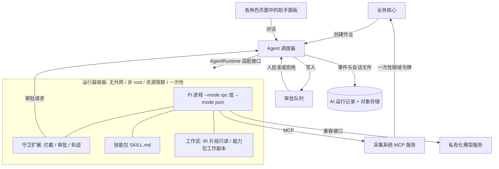

# 03 Agent 调度设计（以 Pi 为默认运行时）

> 本文说明如何在系统中调度 Pi 这类通用 Agent，使其辅助整个采集流程，同时保持“过程留痕、结果由人确认”。
> 假设：“Pi agent”指开源 Agent 运行时 Pi（`earendil-works/pi`，npm 包 `@earendil-works/pi-coding-agent`）。若所指为其他产品，本文 §3、§8 的适配层设计仍然适用，只需替换 §2、§6 的具体接入方式。

## 1. 定位与边界

**总原则：流程由确定性程序编排，Agent 只做叶子节点上的开放性判断。**

| Agent 可以做 | Agent 不可以做 |
|---|---|
| 浏览 IR，为指标给出候选指针 | 输出数值作为候选值 |
| 编写、修改版式能力包并跑回归 | 发布能力包 |
| 诊断校验失败的原因，给出证据 | 修改确认值、复核结论 |
| 回答口径问题（引用指标定义与制度依据） | 代替经办人确认、代替复核人复核 |
| 起草催办消息、复核提要、结论要点、校验规则 | 直接发送催办、调整期限、签署、入库 |
| 归纳在途风险与处置建议 | 作出管理决定 |

Agent 的所有产出只有三种去向：候选指针（进入规则引擎与人工确认）、草稿（由人编辑后使用）、动作提议（进入审批队列）。

## 2. 关于 Pi：已核实的事实与适配性

以下内容核对自 Pi 官方仓库文档（核对日期 2026-11-21，当时版本 1.6.0）。实施时以所安装版本的文档为准。

| 事项 | 文档事实 | 对本方案的意义 |
|---|---|---|
| 定位 | 极简、可扩展的 Agent 运行时；可通过扩展、技能、提示词模板定制；默认不带子代理和计划模式 | 多 Agent 编排由本系统的调度器负责，职责清晰 |
| 许可证 | MIT | 可私有化部署与二次开发 |
| 运行环境 | 需要 Node.js 22.19 或更高 | 运行器镜像需预置 |
| 调用方式 | 交互式；`--print` 单次运行；`--mode json` 单次运行并输出 JSONL 事件；`--mode rpc` 常驻子进程，经标准输入输出收发 JSONL；TypeScript SDK（`createAgentSession`）进程内嵌入 | 批处理与交互式助手两类场景都有对应方式 |
| 运行结束判定 | `agent_end` 之后仍可能有重试或后续工作，需等待 `agent_settled` | 调度器以 `agent_settled` 作为作业结束信号 |
| 内置工具 | `read、bash、edit、write、grep、find、ls`；`--tools` 指定允许清单，`--no-builtin-tools` 关闭内置工具并保留扩展与自定义工具 | 业务类 Agent 关闭内置工具，只留领域工具 |
| 自定义工具 | 扩展通过 `pi.registerTool` 注册带参数模式的工具 | 领域工具的一种接入方式 |
| MCP | 支持经标准输入输出或可流式 HTTP 连接 MCP 服务，配置为 `mcp.json` | 领域工具的推荐接入方式，与运行时无关 |
| 工具调用拦截 | 扩展可订阅 `tool_call` 事件，在执行前修改参数或返回 `{ block: true, reason }` 阻止 | 实现权限校验与人工审批关口 |
| RPC 中的人机交互 | 扩展调用 `ctx.ui.confirm` 等对话方法时，RPC 模式会发出 `extension_ui_request` 并阻塞等待客户端的 `extension_ui_response` | 可把 Agent 的确认请求映射到业务系统的审批队列 |
| 技能 | 实现 Agent Skills 规范：目录加 `SKILL.md`，启动时只加载名称与描述，需要时才读全文 | 领域知识以技能包形式版本化 |
| 会话 | 默认持久化为 JSONL 文件，`--session-dir` 指定目录，`--no-session` 不落盘，`--export` 导出为 HTML | 会话文件即 Agent 过程留痕的原件 |
| 私有模型 | `models.json` 可配置兼容接口的端点（文档列举 Ollama、LM Studio、vLLM、SGLang）；另直接支持 llama.cpp | 满足内网闭环 |
| 离线 | `--offline` 或 `PI_OFFLINE=1` 关闭自动联网行为；设置项 `enableInstallTelemetry` 控制安装与更新上报 | 内网部署时需关闭 |
| 权限 | 扩展与 Pi 进程同权限运行；内置 `bash` 工具执行 shell 命令 | 隔离必须由部署侧（容器）提供 |

**未核实、需在阶段 0 验证的事项**：

1. 现场可用的私有化模型在 Pi 下的工具调用稳定性与任务完成率（这是最大的不确定性，决定 Agent 能承担多少工作）。
2. `--no-builtin-tools` 与内置 MCP 扩展同时使用时的实际工具清单。
3. 单机可并发的 Pi 进程数与资源占用。
4. RPC 模式下审批等待数小时的行为（对话请求的超时与进程保活），不满足时改用 §7.2 的“作业挂起再续跑”方式。

## 3. 总体架构



组件职责：

| 组件 | 职责 |
|---|---|
| Agent 调度器 | 作业队列、并发与预算控制、运行器生命周期、事件采集、审批衔接、结果校验与回写。是确定性程序。 |
| AgentRuntime 适配接口 | 屏蔽具体运行时。Pi 是默认实现，可替换（§8）。 |
| 运行器容器 | 每个作业一个一次性容器，结束即销毁。 |
| 守卫扩展 | 运行在 Pi 进程内，拦截每一次工具调用。 |
| 采集系统 MCP 服务 | 把业务能力暴露为工具，是 Agent 接触业务数据的唯一通道。 |
| 审批队列 | 业务核心中的模块，承接 Agent 的动作提议，也承接能力包、规则的发布审批。 |

## 4. Agent 应用场景

| 编号 | 场景 | 触发 | 主要工具 | 产出 | 人工关口 | 运行方式 |
|---|---|---|---|---|---|---|
| G1 | 版式能力包编写与修复 | 同一版式指纹多次进入 L4；能力包疑似失效；人工纠错累积 | 读样本 IR、读指标定义、编辑工作区内的能力包文件、运行回归 | 能力包草稿、识版报告、回归结果 | 版式运营审核员评审差异，业务负责人批准发布 | 批处理 |
| G2 | 长尾文件候选定位 | 文件走 L4 且规则路径未覆盖的明细 | IR 浏览类工具、`propose_candidate` | 候选指针与理由 | 经办人按 C 档逐项确认 | 批处理 |
| G3 | 校验失败诊断 | 硬性校验失败或合计不平衡 | IR 浏览、读校验结果 | 诊断说明（例如“第 12 行未计入合计”）及证据锚点 | 经办人据此修正 | 批处理 |
| G4 | 填报助手 | 经办人在确认页提问 | 读指标定义与制度依据、读本任务 IR、读答疑记录 | 带引用的回答；可代为发起口径答疑草稿 | 经办人自行采纳 | 交互 |
| G5 | 复核提要 | 任务提交后 | 读清单差异、校验结果、历史值 | 复核关注点列表（修改项、波动项、证据薄弱项），按风险排序 | 复核人逐项决定 | 批处理 |
| G6 | 在途管理助手 | 每日定时；管理员提问 | 读进度与风险聚合、读催办记录、`request_action` | 日报、风险原因归纳、处置提议（催办对象与措辞、延期建议） | 管理员在处置工作台逐条批准 | 定时与交互 |
| G7 | 数据成果起草 | 业务人员在主题页发起 | 读已复核数据、读更正记录 | 结论要点草稿，每句附所引明细链接 | 业务人员编辑确认（原方案 3.8） | 批处理 |
| G8 | 校验规则起草 | 新指标集启用；误报反馈 | 读指标定义、读历史入库数据、试跑规则 | 规则草稿与试跑命中率 | 业务管理员批准发布 | 批处理 |
| G9 | 回归失败分诊 | 回归不通过 | 读回归差异、读变更记录 | 失败归因与修复建议 | 版式运营审核员处理 | 批处理 |

优先级建议：G1、G2、G3 直接提升识别覆盖与准确率，先做；G5、G6 提升管理效率，其次；G4、G7、G8、G9 随后。

**G1 是最重要的用法**：让 Agent 在构建期把一类版式“写成规则”，经人审后运行期确定性执行。这比让 Agent 在运行期逐份文件抽数更稳、更省、更容易审计，也降低了对模型能力的要求——写错了有回归拦着，发布前有人看着。

## 5. 接入方式

| 方式 | 机制 | 适用 | 取舍 |
|---|---|---|---|
| 单次 JSON 模式 | `pi --mode json "<指令>"`，读完事件流即结束 | G1、G2、G3、G5、G7、G8、G9 等批处理 | 最简单；进程即作业，天然隔离 |
| RPC 常驻子进程 | `pi --mode rpc`，按 JSONL 收发命令与事件 | G4、G6 等交互助手；需要中途审批的作业 | 与后端语言无关；需自行处理成帧、背压与进程保活 |
| SDK 进程内嵌入 | Node.js 或 Bun 中调用 `createAgentSession` | 调度器自身用 TypeScript 实现时 | 接口最全；但与调度器同进程，隔离弱 |

建议：调度器用现有后端语言实现，运行器内以子进程方式启动 Pi（批处理用 JSON 模式，交互用 RPC 模式）。理由是进程与容器边界清晰，且不把后端绑定到 Node.js。

RPC 接入需遵守文档中的协议要求：一条记录一行，以换行符分隔；不要用会按 Unicode 行分隔符切分的通用行读取器；持续读取标准输出；为并发命令设置 `id` 并按 `id` 对应响应；以 `agent_settled` 判定结束。

启动示意（参数名取自文档，组合效果需在阶段 0 验证）：

```bash
pi --mode json --offline \
   --no-builtin-tools --no-context-files \
   --no-extensions -e builtin:mcp -e /opt/collect/guard.ts \
   --no-skills --skill /opt/collect/skills/ir-candidate-locating \
   --session-dir /work/session \
   --provider local --model "$MODEL_ID" \
   "$(cat /work/job-prompt.md)"
```

私有模型端点配置（`models.json`）：

```json
{
  "providers": {
    "local": {
      "baseUrl": "http://llm-gateway.internal/v1",
      "api": "openai-completions",
      "apiKey": "$LLM_GATEWAY_KEY",
      "models": [{ "id": "<现场部署的模型标识>" }]
    }
  }
}
```

## 6. 工具层

领域工具统一由“采集系统 MCP 服务”提供。选择 MCP 而不是只写 Pi 扩展工具，是为了让工具层与运行时解耦：换运行时不必重写工具。

工具按副作用分三类，守卫扩展据此处理：

| 类别 | 工具 | 说明 | 守卫策略 |
|---|---|---|---|
| 只读 | `get_task_items` | 当前任务待定位的明细：指标定义、维度、目标单位 | 校验令牌范围后放行 |
| 只读 | `ir_outline` | 文件结构概览：工作表、表格、页、标题 | 同上 |
| 只读 | `ir_get_table` | 取一张表的表头树与指定行列范围，带节点 ID | 同上；限制单次返回量 |
| 只读 | `ir_find` | 按文本、表头路径在 IR 中查找节点 | 同上 |
| 只读 | `get_metric_def`、`get_guidance`、`get_history_anchor` | 指标定义与制度依据、填报说明与答疑、上期同版式的锚点 | 同上 |
| 只读 | `get_progress`、`get_risks`、`get_check_results`、`get_manifest_diff` | 管理与复核类只读数据 | 同上 |
| 提议（无副作用） | `propose_candidate` | 参数为明细 ID、节点 ID、维度、理由；**无数值参数** | 放行；服务端校验节点合法性后生成候选 |
| 提议（无副作用） | `submit_draft` | 提交草稿：复核提要、催办措辞、结论要点、规则、诊断说明 | 放行；按模式校验结构，草稿状态入库 |
| 提议（无副作用） | `run_pack_regression` | 对工作区内的能力包跑回归，返回通过率与差异 | 放行；只在运行器内执行 |
| 动作请求（有副作用） | `request_action` | 请求系统执行动作：发送催办、调整期限、指定跟进人、提交能力包评审 | **不直接执行**，生成审批请求 |

设计要点：

- 没有任何“写确认值、写复核结论、签署、入库、发布”的工具。这些能力不存在于工具层，而不是靠提示词约束。
- 工具返回的是 IR 片段和节点 ID，而不是整份文件，既控制上下文长度，也落实数据最小化。
- 每次工具调用都带作业的一次性令牌，服务端按令牌的任务范围过滤数据；越界请求返回拒绝并记入轨迹。
- G1 需要编辑能力包文件，仅对这一类作业开放 `read、edit、write` 且限定在工作区目录；回归通过 `run_pack_regression` 工具执行，不开放 `bash`。

## 7. 人在回路

### 7.1 三道关口

| 关口 | 位置 | 机制 |
|---|---|---|
| 工具调用前 | 守卫扩展 | 订阅 `tool_call`：不在作业允许清单内的工具一律阻止；参数越界阻止；动作请求类转审批 |
| 产出回写前 | 调度器 | 按作业类型的结果模式校验；候选指针经规则引擎校验；不合格则丢弃并记录 |
| 生效前 | 业务流程 | 候选须经办确认与业务复核；草稿须人编辑确认；能力包与规则须审批发布 |

守卫扩展示意（接口取自文档的扩展快速上手与 `tool_call` 说明，具体签名以所装版本为准）：

```typescript
import type { ExtensionAPI } from "@earendil-works/pi-coding-agent";

const policy = JSON.parse(process.env.COLLECT_JOB_POLICY ?? "{}"); // 调度器按作业注入

export default function (pi: ExtensionAPI) {
  pi.on("tool_call", async (event, ctx) => {
    const name = event.toolName;

    if (!policy.allowedTools?.includes(name)) {
      return { block: true, reason: `工具 ${name} 不在本作业允许清单内` };
    }
    if (policy.approvalTools?.includes(name)) {
      // RPC 模式下会转成 extension_ui_request，由调度器映射到审批队列
      const ok = await ctx.ui.confirm("需要人工批准", JSON.stringify(event.input));
      if (!ok) return { block: true, reason: "审批未通过" };
    }
  });
}
```

### 7.2 审批的两种衔接方式

| 方式 | 流程 | 适用 |
|---|---|---|
| 同步等待 | 守卫调用确认对话 → 调度器收到 `extension_ui_request` → 写入审批队列 → 人处理后回 `extension_ui_response` | 交互助手中，人就在页面前，秒级到分钟级 |
| 挂起续跑 | `request_action` 只登记审批请求并立即返回“已提交审批”；作业结束。审批通过后由业务核心执行动作，必要时带着审批结果新建后续作业 | 批处理和定时作业，审批可能隔天 |

建议默认用挂起续跑：不占用运行器，也不依赖长时间保活。动作最终由业务核心以批准人的身份执行并留痕，Agent 只是提议者。

### 7.3 审批请求内容

审批页面展示：提议的动作与参数、Agent 给出的理由及所引数据链接、作业与会话轨迹入口、触发人、影响范围预览。批准人可修改参数后批准（例如改催办措辞），修改前后都记录。批量提议支持逐条勾选，不提供无差别“全部批准”。

## 8. 可替换性

```typescript
interface AgentRuntime {
  start(spec: AgentJobSpec): Promise<RunHandle>;
  events(run: RunHandle): AsyncIterable<AgentEvent>;   // 统一事件：turn / tool_call / tool_result / message / settled / error
  send(run: RunHandle, input: UserInput | ApprovalResult): Promise<void>;
  abort(run: RunHandle): Promise<void>;
  collectArtifacts(run: RunHandle): Promise<Artifact[]>; // 会话文件、工作区产物
}
```

替换运行时只需实现该接口并把其原生事件映射为统一事件。不随运行时变化的部分是：MCP 工具层、技能包内容（Agent Skills 是开放规范）、作业规格、审批队列、轨迹存储。与 Pi 强绑定的只有守卫扩展和启动参数，这部分代码量很小。

作业规格：

```json
{
  "job_id": "AJ-01HX…",
  "type": "G2_candidate_locating",
  "triggered_by": { "type": "user", "id": "U123" },
  "scope": { "task_id": "T-…", "file_ids": ["F-…"], "item_ids": ["IT-…"] },
  "runtime": { "kind": "pi", "mode": "json", "model": "local/<模型标识>" },
  "skills": ["ir-candidate-locating@1.3.0"],
  "tools": { "allowed": ["get_task_items", "ir_outline", "ir_get_table", "ir_find", "get_history_anchor", "propose_candidate"], "approval": [] },
  "budget": { "max_wall_seconds": 600, "max_tool_calls": 200, "max_output_tokens": 50000 },
  "result_schema": "candidate_pointer_list@1"
}
```

## 9. 安全

| 风险 | 措施 |
|---|---|
| 运行时本身无隔离 | 一次性容器；非 root；只读根文件系统，仅工作区可写；无外网，只能访问模型网关与 MCP 服务；CPU、内存、时长限额 |
| 提示注入（文件内容诱导 Agent） | 无产数能力、无写工具、动作需审批、数据范围按令牌限定；IR 文本作为工具结果返回而非拼入系统提示词；轨迹可审 |
| 越权读数据 | 一次性令牌，权限为触发人权限与作业类型权限的交集，作业结束即失效 |
| 扩展与技能包供应链 | 只从内网制品库加载，固定版本与摘要；启动时 `--no-extensions`、`--no-skills` 后显式指定路径 |
| 失控消耗 | 调度器强制预算：时长、工具调用次数、输出量；超限即中止并记录 |
| 模型输出不合规 | 结果按模式校验；不合格不回写 |
| 自动联网 | `--offline`；关闭安装与更新上报；镜像内不保留包管理器的外网源 |

## 10. 留痕

每个 Agent 作业写一条 AI 运行记录（02 §8.4），并保存：

- 作业规格原文（含技能包版本、模型、工具清单、预算）。
- Pi 会话 JSONL 文件原件及其摘要，存对象存储；可用 `--export` 生成 HTML 供人阅读。
- 调度器采集的统一事件序列：每次工具调用的名称、参数摘要、结果摘要、是否被守卫阻止及原因。
- 审批请求及处理结果。
- 产出与其去向：生成了哪些候选、草稿、提议，最终被采纳、修改还是拒绝。

候选值记录 `agent_run_id`，因此从任何一个入库值都能回到“是哪次 Agent 运行、读了哪些表、为什么指向这个单元格”。

## 11. 技能包

领域知识写成 Agent Skills（目录加 `SKILL.md`），放内网 Git 仓库，版本号进入作业规格与轨迹。

| 技能包 | 用于 | 内容要点 |
|---|---|---|
| `ir-candidate-locating` | G2 | 先看结构概览再取表；先定表头路径再定行；维度（期间、口径）的判定顺序；何时应放弃并说明原因 |
| `layout-pack-authoring` | G1、G9 | 能力包规格；用路径匹配而非坐标；如何写指纹；如何读回归差异；常见版式陷阱（左右分区、续表、其中项） |
| `reconciliation-diagnosis` | G3 | 合计不平衡的排查步骤：隐藏行、其中项重复计入、单位不一致、跨表 |
| `review-brief` | G5 | 复核关注点的排序规则与输出格式 |
| `progress-digest` | G6 | 风险原因归纳口径、催办措辞规范、何时提议延期 |
| `finding-draft` | G7 | 只引用已复核数据；每句带引用；不下结论性判断 |
| `rule-drafting` | G8 | 规则语法、试跑要求、误报控制 |

示例：

```markdown
---
name: ir-candidate-locating
description: 在已解析的报表结构中为待填指标定位源单元格并提交候选指针。用于陌生版式文件的指标定位。
---

# 指标候选定位

1. 调用 get_task_items 取得待定位明细，逐条处理。
2. 调用 ir_outline 了解文件结构；用 ir_find 按指标名称与别名检索，再用 ir_get_table 查看所在表的表头树。
3. 先确定列（期间、口径、数据状态），再确定行（指标、其中项层级）。
4. 用 get_history_anchor 对照上期位置；不一致时在理由中说明。
5. 只通过 propose_candidate 提交节点 ID 与理由。不要在任何地方写出或计算数值。
6. 找不到或有两个以上同等可能的位置时，全部提交为候选并说明差异，或明确报告“未找到”。不要猜。
```

## 12. 评测与上线门槛

- **任务集**：每个场景准备一组带标准答案的真实任务（G2 为“文件 + 明细 → 正确锚点”，G1 为“样本文件 → 能通过回归的能力包”）。
- **指标**：完成率、正确率、越权或被阻止的调用次数、平均耗时与用量。
- **门槛**：各场景建议值见 04 §3。未达门槛的场景不上线，对应环节保持人工。
- **变更即重测**：模型、技能包、工具接口、Pi 版本任一变化都重跑任务集。会话文件可用于回放比对。
- **线上监控**：G2 候选被经办修改的比例、G1 能力包首次评审通过率、提议被批准的比例。持续走低即回退版本或降级为人工。
